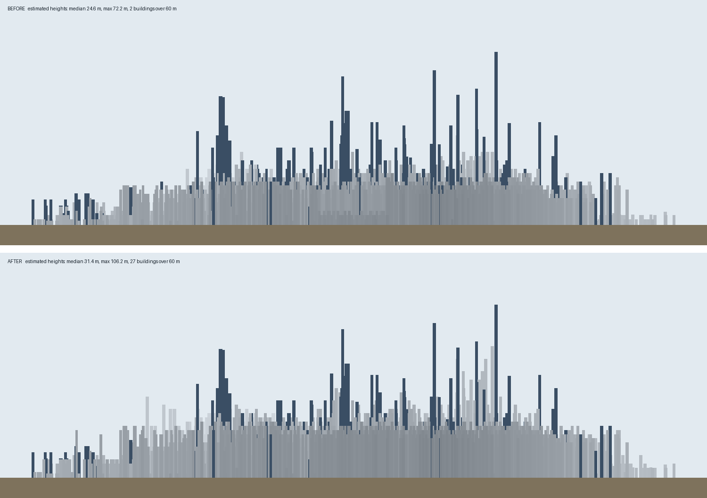

# How building heights are estimated, and how it was measured

92% of the CBD has no height in OpenStreetMap: **2,821 of 3,072** buildings. Those heights
are guessed in the bake. This is the record of what "guessed" means, what was measured, and
why the model changed on 2026-11-12.

## The measurement

Any model here can be checked honestly, because 251 buildings _do_ have real heights. The
method is leave-one-out: hide one real height, predict it from the others, compare, repeat
251 times. Fitting a model and scoring it on the same data would flatter it; this cannot.

Two numbers matter. **MAE** is average error in metres. **Bias** is the average _signed_
error — a model with small MAE and large bias is wrong the same way every time, and bias is
what makes a skyline look systematically flat or inflated.

## What was compared

| Model                                          | MAE        | Bias       |
| ---------------------------------------------- | ---------- | ---------- |
| Type + neighbourhood rule (the old estimator)  | **18.0 m** | **−9.9 m** |
| Nearest 13 tagged heights, weighted 1/distance | **13.7 m** | **+1.3 m** |

The old rule was not merely imprecise. It was **9.9 m too short on average**, and the error
was concentrated exactly where it shows:

| true height | n   | old MAE / bias   | new MAE / bias   |
| ----------- | --- | ---------------- | ---------------- |
| 0–20 m      | 52  | **12.6 / +11.2** | 16.0 / +15.8     |
| 20–40 m     | 101 | **8.8 / −1.8**   | 10.0 / +7.1      |
| 40–60 m     | 49  | 14.1 / −12.3     | **9.1 / −2.3**   |
| 60 m+       | 49  | 46.6 / **−46.6** | **23.5 / −22.6** |

So it is a real trade-off, not a free win: the old rule is better under 20 m, where typing a
building genuinely helps, and much worse above 60 m, where 49 towers were underestimated by
an average of 46.6 m. Overall accuracy won by 4.3 m and the bias went from −9.9 m to +1.3 m.

Everything else was measured and rejected as a predictor:

- **Footprint area**: Pearson r on log(area) against height was **−0.024** (r² = 0.001). The
  banded medians are flat (38.2 / 31.4 / 38.2 / 34.8 m). Area does not predict height.
- **Distance from the KICC**: medians fall from 97.5 m inside 250 m to 20.0 m beyond 1.5 km.
  Real, but it is a crude version of what the neighbour model already does better.
- **The building's own type**: helps under 20 m and for a handful of civic names. It is kept
  where the type settles the question (a kiosk is 3 m whatever is beside it) and dropped
  where it does not.

## The implemented model

`createHeightEstimator` in `scripts/osm/lib/heights.ts`:

1. A type with a fixed height wins outright (kiosk 3 m, cathedral 22 m).
2. Under 40 m² returns 3 m — though in practice all 506 such buildings already have real
   heights, so this is a safety net rather than a rule that fires.
3. Types with a typical floor count keep it (warehouse, apartments, hotel…).
4. Otherwise: the **13 nearest tagged heights, weighted by 1/distance**.
5. The slenderness cap (3.2 × √area) still applies, and a jitter so a street is not a row of
   identical boxes. Both cost accuracy — removing them measures 15.9 m instead of 17.1 m —
   but both are there to stop _placing_ errors, which this metric does not see: a shed
   cannot be 90 m tall because a tower stands next to it.

With the guards in place, the real, shipped estimator measures **17.1 m MAE and −2.1 m
bias**. The 13.7 m figure is the unguarded model; the gap is the price of the cap and the
jitter, and it is worth paying.

## What it did to the city

|                               | median   | p90      | max       | over 60 m |
| ----------------------------- | -------- | -------- | --------- | --------- |
| estimated, before             | 24.6     | 34.8     | 72.2      | **2**     |
| estimated, after              | **31.4** | **41.6** | **106.2** | **27**    |
| real buildings, for reference | 34.8     | 75.6     | 140.0     | 49        |

Grey is estimated, dark blue is a measured OSM height. Before, the estimated mass sat in a
plateau far below the towers; after, it rises to meet them.

## What this does not fix

The estimated distribution still stops at 106 m against a real 140 m, and only 27 estimates
exceed 60 m against 49 real ones. The remaining error is dominated by buildings that cannot
be predicted from neighbours at all:

- **Times Tower**, the tallest at 140 m, has a footprint of **495 m²** — the model's own
  slenderness cap allows it 72 m. It is a real height, so this only affects buildings like
  it that are untagged.
- Several of the largest errors come from footprints of **1–7 m²** — antennas, masts and
  tower cores split from their podiums. There are 84 buildings under 10 m². No amount of
  neighbouring information predicts a 92 m mast on a 0.9 m² footprint.

That is the honest ceiling of this approach. Closing it needs **real heights**, which needs
`npm run osm:fetch` on a machine with open egress — the 292 named CBD landmarks that have
none in OSM today.
